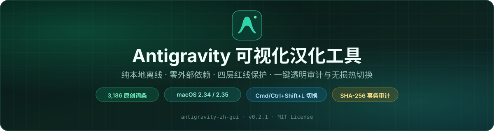
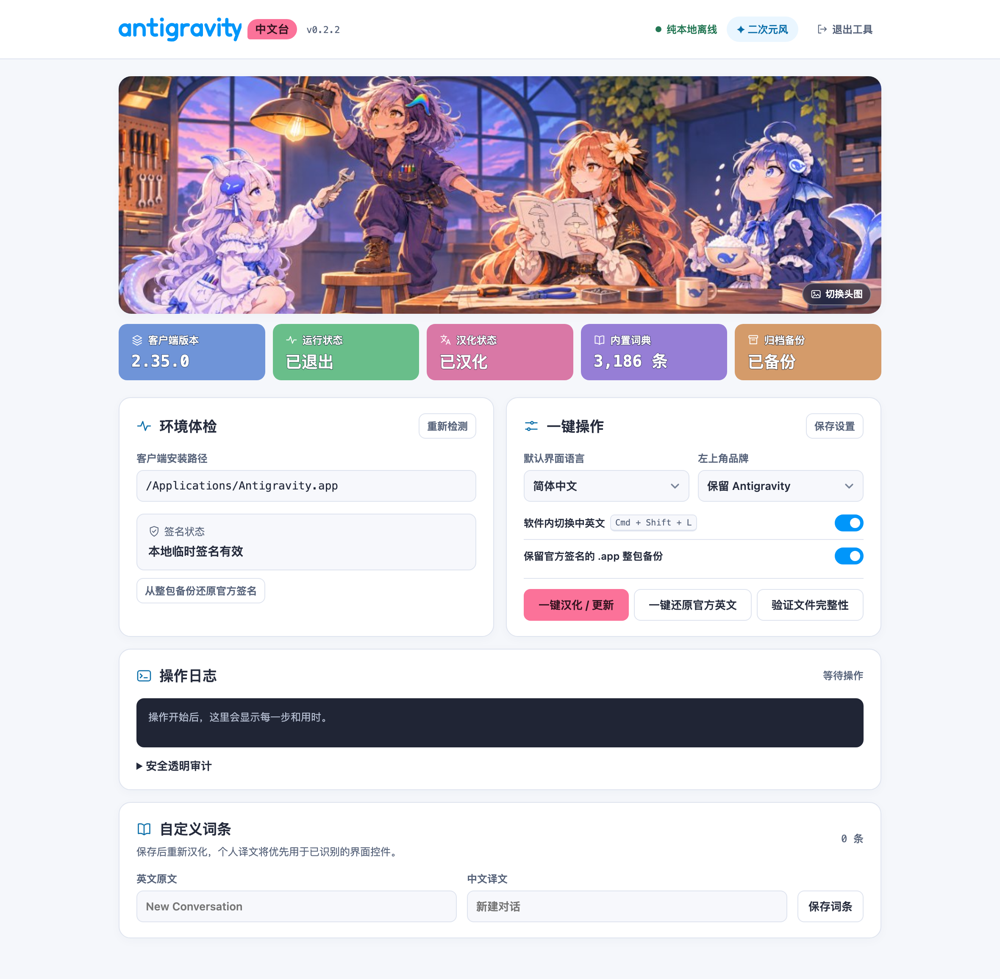
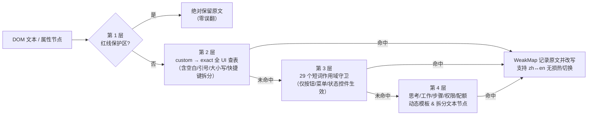

<div align="center">



<br/>

[](https://github.com/chiefcapitalhu/antigravity-zh-gui/actions/workflows/ci.yml)


[](LICENSE)

<p>
  <strong>纯本地离线、可逐字节审计的 Antigravity 2.x 简体中文可视化汉化工具</strong><br/>
  双击单文件即开本地控制台 · 四层红线零误翻引擎 · <code>Cmd/Ctrl + Shift + L</code> 秒切中英文 · 一键完整还原官方签名
</p>

<p>
  <a href="#核心特性">核心特性</a> ·
  <a href="#控制台预览">控制台预览</a> ·
  <a href="#支持状态">支持状态</a> ·
  <a href="#快速上手">快速上手</a> ·
  <a href="#四层安全匹配架构">四层架构与红线保护</a> ·
  <a href="#命令行与词典校验">命令行</a> ·
  <a href="#常见问题">常见问题</a>
</p>

</div>

---

## 核心特性

| 特性 | 说明 |
|---|---|
| **3,186 条 100% Clean-Room 原创词条** | 所有英文原文均以只读方式提取自官方 Antigravity 客户端，中文译文全部原创且逐条记录 `source` 与字节 `offset`，支持 `extract --verify` 全量原位重放验证。 |
| **四层安全 DOM 匹配引擎** | 严密保护用户消息、AI 回复、**展开后的思考过程正文**（放行外层折叠标题按钮）、代码、终端、Diff、输入框、会话标题、Git 分支与 PDF 文本层；保护区外全 UI 查表、短词作用域守卫与完整动态模板。 |
| **完整聊天工作与思考状态条** | 覆盖 `Thinking...`、`Thought for <时长>`、`Worked for <时长> · N updates`、`Explored N files, M searches`、聊天内权限审批选项、模型配额/相对时间及 React 拆分文本节点。 |
| **一键中英文无损热切换** | 本地 Hub 窗口内按 **`Cmd + Shift + L`**（macOS）或 **`Ctrl + Shift + L`**（Windows）即时切换中英文，基于 `WeakMap` 精确恢复原始文本与属性，不破坏节点引用。 |
| **13 个受控白名单主进程模块** | 覆盖菜单、托盘、Dock、右键菜单、更新、文件选择、SSH 远程弹窗、设备/通行密钥选择器、网页连接信息、WSL 启动页与安装向导；支持 2.34.0 / 2.35.0 多版本哈希精确匹配。 |
| **原子事务 + 透明审计 + 降级标红** | 修改先在同盘临时副本完成并核验 SHA-256 白名单后再原子替换；支持 macOS 官方原签名整包备份与一键还原；遇未适配新版触发 `hub_skipped` 降级时，面板明确标红提示「部分汉化（已降级）」。 |
| **纯本地离线 · 零外部依赖** | 仅使用 Go 标准库（`go list -m all` 零第三方依赖）；控制台仅监听随机 `127.0.0.1` 端口并校验 Token/Host/Origin；运行时零网络请求、禁用 `innerHTML`/`eval`。 |

---

## 控制台预览

控制台默认采用二次元风格，亮色显示工坊合照，暗色显示反重力少女。点击「切换头图」可更换插画，点击导航栏的「✦ 二次元风」可切换到极简模式。同一控制台地址刷新后会保留选择。

<div align="center">
  <picture>
    <source media="(prefers-color-scheme: dark)" srcset="docs/assets/panel-dark.png">
    <source media="(prefers-color-scheme: light)" srcset="docs/assets/panel-light.png">
    
  </picture>
</div>

---

## 支持状态

| 平台 | Antigravity 版本 | 核验状态 | 说明 |
|---|---|---|---|
| **macOS**（Apple Silicon / Intel） | `2.34.0`、`2.35.0` | ✅ **已完整基线核验并实机验收** | 13 个主进程模块 + 完整 Hub 渲染层 + 3,186 词条 + 官方整包备份还原 |
| **Windows**（x64 / ARM64） | `2.x` | 🚧 **提供源码与基础构建支持** | 已具备宿主完整性策略校验与 CI 构建/单测，**尚未完成官方 Windows 实机基线验收** |

> **版本升级保护**：当官方客户端升级到尚未复核的新版本时，工具绝不会盲目写入未知字节。如仅触发基础弹窗降级补丁（`hub_skipped`，未注入主界面与热切换），`status` 与控制台会明确标红提示 **「部分汉化（已降级）」**，提醒等待或更新汉化工具。

---

## 快速上手

### 方式一：本地可视化控制台（推荐）

1. **获取程序**：下载对应架构的构建产物，或按 [从源代码构建](#从源代码构建) 本地编译。
   - macOS Apple 芯片选 `darwin-arm64`，Intel 芯片选 `darwin-amd64`；传输后若无执行权限，运行 `chmod u+x 文件名`。
2. **完全退出 Antigravity**：先保存工作并彻底退出客户端（macOS 按 **`Cmd + Q`**）。
3. **打开控制台并体检**：双击（或终端运行）汉化工具，浏览器会自动打开本地控制台，确认「环境体检」中显示 **已退出** 与正确的客户端版本。
4. **勾选整包备份并一键汉化**：
   - 首次在 macOS 上操作时，强烈建议勾选 **「保留官方签名的 .app 整包备份」**（备份至 `~/Documents/Antigravity-Official-Backup.app`），便于日后一键恢复 Google 原版签名。
   - 选好默认语言、快捷键与左上角品牌显示方式后，点击 **「一键汉化 / 更新」**；完成后可展开 **「安全透明审计」** 核对每个修改文件的前后大小与 SHA-256。
5. **启动体验 & 热切换**：重新启动 Antigravity 即可看到简体中文界面，随时按 **`Cmd + Shift + L`**（Mac）/ **`Ctrl + Shift + L`**（Windows）中英文热切换。
6. **个人自定义词条**：可在控制台底部增删个人译文（例如把 `New Conversation` 改为「开始新对话」），保存后再次点击「一键汉化 / 更新」生效。使用完毕后点击右上角 **「退出工具」** 关闭本地服务。

### 方式二：先在应用副本上零风险试水

如果你希望先不改动 `/Applications/Antigravity.app` 本体：

```bash
ditto /Applications/Antigravity.app ~/Desktop/Antigravity-Test.app
```

1. 退出所有 Antigravity 进程，在控制台路径框填入副本的完整绝对路径，点击 **「重新检测」**。
2. 点击 **「一键汉化 / 更新」** → **「验证文件完整性」**，展开审计核对改动成员。
3. 启动副本验收界面与 `Cmd + Shift + L` 热切换，确认满意后再决定是否应用到本体，测试完直接删除副本即可。

---

## 四层安全匹配架构



### 红线保护清单（永远不翻译）

- **对话与思考正文**：用户消息、AI 回复、Rendered Markdown（`[data-markdown-root]`）、**展开后的思考过程正文**（`[data-testid="thinking-collapsible-trigger"] ~ div`）、语音转写与追问气泡、AI 提问选项。
- **代码、终端与文件**：`pre`/`code`、Monaco / CodeMirror 编辑器、Diff 视图、内置与独立终端（`xterm` / `.terminal` / `terminal-surface`）、脚本输出、PDF 文本层、CSV/HTML/Notebook 预览、文件路径与 URI。
- **用户与外部实体名称**：输入框 / `contenteditable` / Lexical 编辑器内容、侧栏全部会话列表标题、Git 分支/仓库/项目名、SSH 主机名、模型原始名称、外部网页 `iframe` 与网页弹窗正文。

---

## 命令行与词典校验

```bash
# 查看版本与环境状态
./antigravity-zh-gui --version
./antigravity-zh-gui status --target "/Applications/Antigravity.app"

# 汉化（macOS 建议首次加 --backup-app 保留官方整包备份）
./antigravity-zh-gui apply --target "/Applications/Antigravity.app" --hotkey=true --default-lang=zh --brand=keep --backup-app

# 完整性审计 / 还原英文 / macOS 还原官方签名整包
./antigravity-zh-gui verify --target "/Applications/Antigravity.app"
./antigravity-zh-gui restore --target "/Applications/Antigravity.app"
./antigravity-zh-gui restore --target "/Applications/Antigravity.app" --backup-app
```

开发者只读提取与原位证据重放（不会写入目标客户端）：

```bash
./antigravity-zh-gui extract --target "/Applications/Antigravity.app" --out /tmp/ag-report
./antigravity-zh-gui extract --target "/Applications/Antigravity.app" --verify ./locales/zh-CN --out /tmp/ag-reviewed
./antigravity-zh-gui extract --target "/path/to/newer/Antigravity.app" --diff /tmp/ag-report/candidates.json --out /tmp/ag-diff
```

v0.2.2 的完整词典证据基线是 macOS arm64 版 Antigravity 2.35.0。除 ASAR 和 Hub 脚本外，提取器还会核对 `bin/language_server` 的完整 SHA-256，再按字节偏移重放 45 个静态字段，涵盖 24 条斜杠命令说明、4 条界面布局文案、8 组内置插件货架的标题和说明，以及市场底部的第三方工具声明。运行时使用内嵌译文，配额服务下发的时长和额度说明按卡片中的固定句式匹配。

词典目录位于 [`locales/zh-CN/`](locales/zh-CN/)（`core`、`workspace`、`settings`、`agents`、`menus_dialogs` 五个模块），设计文档与历次验收回执见 [`docs/`](docs/) 与 [`CHANGELOG.md`](CHANGELOG.md)。

---

## 从源代码构建

本项目主程序仅依赖 **Go 标准库**（CI 最低兼容 Go 1.22.x），正式产物已内嵌全部词典与前端资源，运行时无需 Go 或 Node 环境。

```bash
# macOS
CGO_ENABLED=0 go build -ldflags=-B=gobuildid -o antigravity-zh-gui ./cmd/antigravity-zh-gui
./antigravity-zh-gui
```

```powershell
# Windows PowerShell
go build -o antigravity-zh-gui.exe ./cmd/antigravity-zh-gui
.\antigravity-zh-gui.exe
```

运行全套本地验证（Go 单测 + 前端策略测试 + 无头 Chrome 回归测试）：

```bash
go list -m all
go vet ./...
go test -count=1 ./...
node --test tests/native.test.cjs tests/runtime-policy.test.cjs
node tests/browser.cjs
node tests/panel.cjs
```

生成发布产物与校验和（`SHA256SUMS.txt`）：

```bash
bash scripts/build-release.sh dist
```

---

## 常见问题

<details>
<summary><strong>1. macOS 汉化后为什么要重签？会有什么影响？</strong></summary>

修改 `app.asar` 并更新 `Info.plist` 完整性摘要后，macOS 要求对应用包执行本地临时签名（ad-hoc `codesign`）。这不会改动你的对话数据与本地数据库，但可能导致 macOS 重新询问一次麦克风/录屏/目录访问等隐私权限，且在汉化期间官方内置自动更新会因签名变更而无法直接校验。开启「整包备份」后，随时可点 **「从整包备份还原官方签名」** 完整回到原版 Google 签名。

</details>

<details>
<summary><strong>2. 为什么 Antigravity 升级后控制台显示「部分汉化（已降级）」？</strong></summary>

为了防止在新版客户端中写坏文件或破坏本地窗口身份校验，工具只对已人工审计并登记 SHA-256 摘要的模块注入主界面运行时。当 Antigravity 升级到尚未复核的新版本时，会触发安全降级并明确标红提示。此时可先还原英文，待工具更新适配新版本后再重新一键汉化。

</details>

<details>
<summary><strong>3. <code>Cmd/Ctrl + Shift + L</code> 和客户端快捷键冲突怎么办？</strong></summary>

在控制台中关闭「软件内切换中英文」开关，保存后重新点击「一键汉化 / 更新」，即可把该快捷键交还给 Antigravity。

</details>

<details>
<summary><strong>4. 配置文件、备份与缓存分别放在哪里？</strong></summary>

- **归档备份**：客户端包内 `app.asar.zh-gui.bak`
- **macOS 官方整包备份**：`~/Documents/Antigravity-Official-Backup.app`
- **偏好与自定义词典**：macOS 为 `~/.config/antigravity-zh-gui/`，Windows 为 `%APPDATA%\antigravity-zh-gui\`
- **缓存清理**：仅在默认探测安装提交成功后清理预定义的 Chromium 渲染缓存，绝不触碰会话、数据库与凭据目录；指定副本路径时不清理真实缓存。

</details>

---

## 参与贡献与开源协议

欢迎提交漏翻反馈、译文改进建议或新版本适配 PR，请参阅 [CONTRIBUTING.md](CONTRIBUTING.md) 与 [CHANGELOG.md](CHANGELOG.md)。

本项目基于 [MIT License](LICENSE) 开源。Antigravity 客户端及其官方安装文件版权归原发行方所有，本工具不包含任何官方客户端二进制或专有资产。
